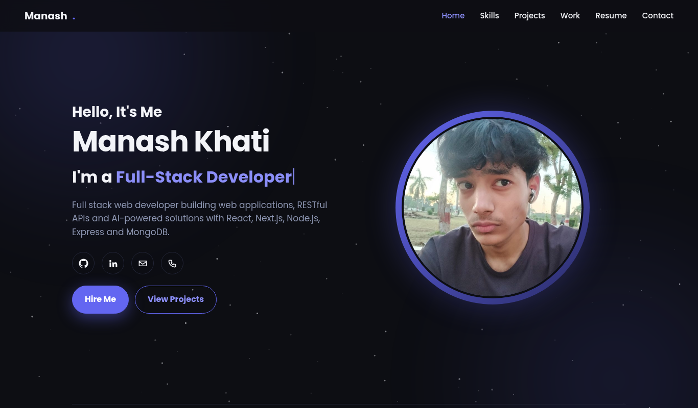
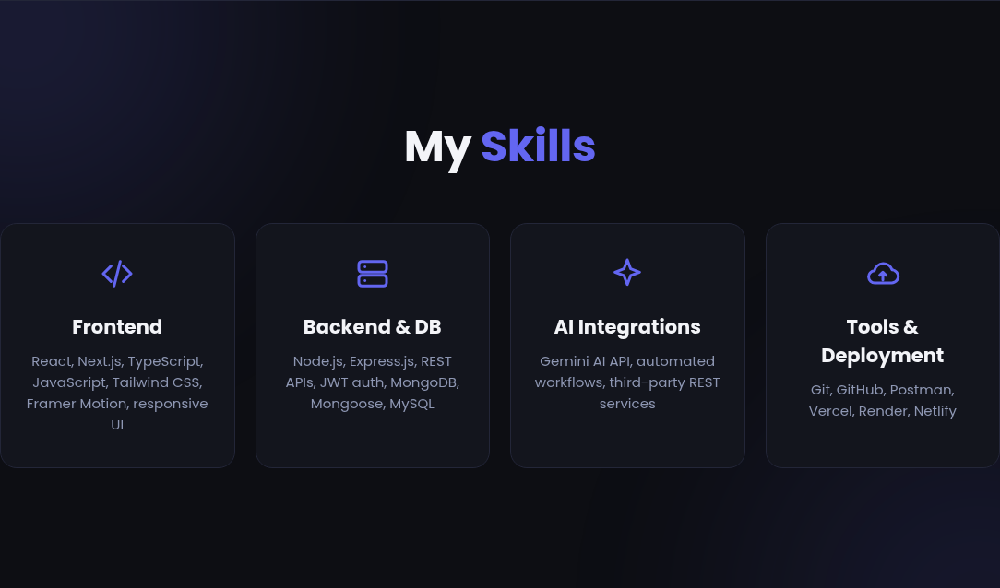
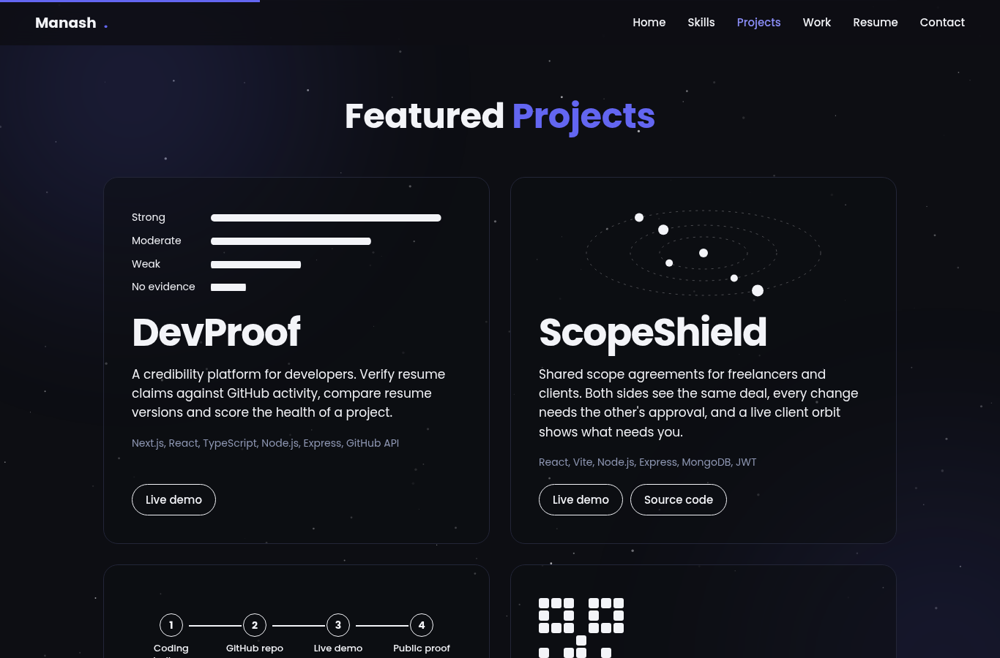
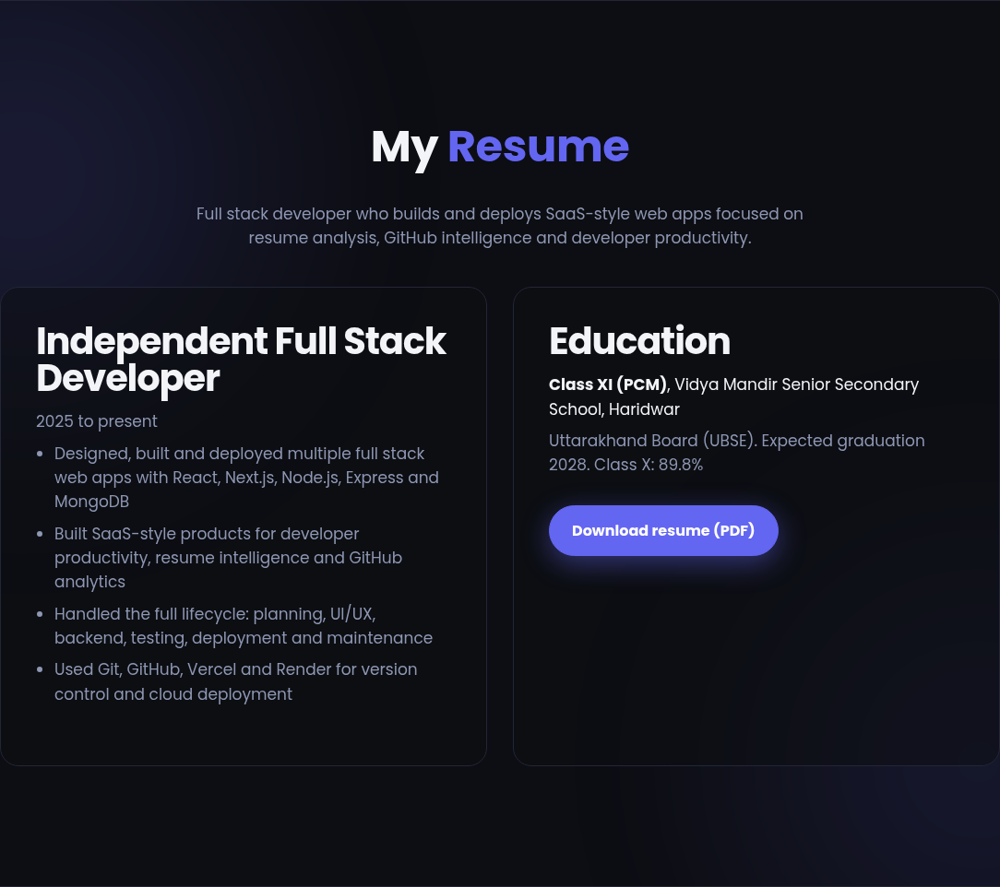

<div align="center">

# Manash Khati — Developer Portfolio

**Full Stack Developer · React · Next.js · Node.js · MongoDB**

A fast, animated, single-page portfolio showcasing SaaS-style products, AI-powered tools and full stack web apps — each with a live demo.

[](https://manash-dev-portfolio.netlify.app/)
[](https://github.com/manashwebdev)
[](https://www.linkedin.com/in/manash-khati-b7a1b6385/)
[](mailto:manashrebuilds@gmail.com)

**🔗 [manash-dev-portfolio.netlify.app](https://manash-dev-portfolio.netlify.app/)**

</div>

---

## Table of Contents

- [About Me](#about-me)
- [Preview](#preview)
- [Featured Projects](#featured-projects)
- [More Work](#more-work)
- [Skills](#skills)
- [Portfolio Features](#portfolio-features)
- [Tech Stack](#tech-stack)
- [Run Locally](#run-locally)
- [Deployment](#deployment)
- [Project Structure](#project-structure)
- [Contact](#contact)

---

## About Me

I'm a full stack developer from Haridwar, Uttarakhand, India, working independently since 2025. I design, build and deploy SaaS-style web applications focused on **developer productivity, resume intelligence, GitHub analytics and freelancer-client collaboration**, handling the full lifecycle: planning, UI/UX, backend, testing, deployment and maintenance.

**What I work with:** React, Next.js, TypeScript, Node.js, Express.js, MongoDB, REST APIs, JWT authentication and Gemini AI integrations, deployed on Vercel, Render and Netlify.

---

## Preview

### Hero


### Skills


### Featured Projects


### Resume


---

## Featured Projects

### 🔍 DevProof — Developer credibility platform
Verify resume claims against real GitHub activity, compare resume versions and score the health of a project.

- **Verify Resume Claims:** upload a resume and a GitHub username. Each skill is rated **Strong, Moderate, Weak or No Evidence**, and a **Trust Score** summarizes how well the claims are supported.
- **Resume Diff:** compare two resume versions to see skills added and removed, changed content and which version looks stronger.
- **GitHub Project Health:** analyzes README quality, documentation, structure, activity and missing sections, then returns a health score with prioritized fixes.
- **History:** saves past analyses in MongoDB so they can be reviewed or deleted.

**Stack:** React, Vite, Tailwind CSS, Framer Motion, Node.js, Express.js, MongoDB, Mongoose, GitHub API
[Live Demo](https://devproof-eight.vercel.app/) · [Source Code](https://github.com/manashwebdev/devproof)

---

### 🛒 ShopQR — QR menu & catalog SaaS
Turn any local shop into a digital storefront in about 2 minutes.

- Catalog builder with products, categories, photos and drag-to-reorder
- Branded QR codes (rounded, gradient or branded), exportable as PNG and SVG
- WhatsApp ordering with a pre-filled *Order now* message on every product
- Analytics for views, QR scans, clicks and top products
- Seasonal themes and AI-written product descriptions powered by Gemini
- Secure by design: bcrypt password hashing, JWT sessions, account lockout, rate limiting and owner-scoped authorization
- Free plan (12 products) and Pro plan (unlimited)

**Stack:** Next.js 15, Express.js, MongoDB, Gemini API, Cloudinary, Docker, GitHub Actions
[Live Demo](https://shopqr-nine.vercel.app/) · [Source Code](https://github.com/manashwebdev/shopqr)

---

### 🛡️ ScopeShield: Shared scope agreements for freelancers and clients
Both sides see the same deal, and every change needs the other side's approval.

- **Shared agreement:** deliverables, exclusions, budget and dates in one view for freelancer and client
- **Two-sided approvals:** either side can propose a change, only the other side can approve it
- **Private share link:** clients review and respond without creating an account, with live sync between both views
- **Client Orbit:** a canvas visualization that ranks projects by urgency, pending decisions and due dates
- **Secure sign-in:** scrypt-hashed passwords, JWT sessions, login rate limiting and owner-scoped authorization on every project route

**Stack:** React, Vite, Node.js, Express.js, MongoDB, JWT, Canvas API
[Live Demo](https://scopeshield-pi.vercel.app/) · [Source Code](https://github.com/manashwebdev/scopeshield)

---

### ✅ SkillProof Lite — Proof-based skill validation
Developers prove skills through coding challenges, GitHub repos, live demos and public proof pages instead of just claiming them on a resume.

[Live Demo](https://skill-proof-lite.vercel.app/)

---

## More Work

**The tools behind DevProof**

| Project | What it does | Links |
|---|---|---|
| Resume Claim Verifier | Checks resume skills against public GitHub work and gives a Trust Score | [Live](https://resume-claim-verifier.vercel.app/) · [Code](https://github.com/manashwebdev/Resume-Claim-Verifier) |
| ResumeDiff | Compares two resume versions and reports what changed in skills and content | [Live](https://resume-diff-azure.vercel.app/) · [Code](https://github.com/manashwebdev/ResumeDiff) |
| GitHub Project Health Analyzer | Reviews README quality and project structure, then suggests fixes | [Live](https://git-hub-project-health-analyzer.vercel.app/) · [Code](https://github.com/manashwebdev/GitHub-Project-Health-Analyzer) |

**Earlier work**

| Project | What it does | Links |
|---|---|---|
| RepoCosmos | Turns any public GitHub repo into an interactive 3D galaxy with a time slider that replays how the project grew | [Live](https://repocosmos.vercel.app/) |
| Luxury Salon Management | Salon site with a MongoDB-backed operations dashboard | [Live](https://manash-luxury-salon.netlify.app) |
| Thock | Mechanical keyboard sounds in the browser: synthesized switch audio, a typing test, a shareable switch builder and music that follows your typing speed | [Live](https://thock-eta.vercel.app) |
| Oath | Track every promise you make and see who's waiting on you in a live orbit, with a trust score and overdue alerts | [Live](https://oath-two-topaz.vercel.app) |
| Foresight | Calibration lab for your predictions: log what you expect, resolve it later, and see if your confidence matches reality | [Live](https://foresight-ten-nu.vercel.app) |

---

## Skills

| Area | Technologies |
|---|---|
| **Frontend** | React, Next.js, TypeScript, JavaScript, Tailwind CSS, Framer Motion, responsive UI |
| **Backend & Database** | Node.js, Express.js, REST APIs, JWT auth, MongoDB, Mongoose, MySQL |
| **AI Integrations** | Gemini AI API, automated workflows, third-party REST services |
| **Tools & Deployment** | Git, GitHub, Postman, Vercel, Render, Netlify |

---

## Portfolio Features

- Animated hero with a variable-weight name that reacts to the cursor and a typing role headline
- Starfield canvas background with subtle parallax
- Scroll progress bar and active-section highlighting in the navbar
- Project cards with animated visuals and reveal-on-scroll effects
- Built-in **resume download** (PDF embedded in the page, so it always works offline)
- Contact form powered by Formspree, with an email fallback
- Dark theme with light-mode support, fully responsive down to mobile
- Respects `prefers-reduced-motion` and uses accessible labels and focus styles
- Zero dependencies: one self-contained HTML file, no build step

---

## Tech Stack

| Layer | Technology |
|---|---|
| Markup & Styling | HTML5, CSS3 (custom properties, grid, flexbox) |
| Behavior | Vanilla JavaScript, Canvas API, IntersectionObserver |
| Typography | Poppins (Google Fonts) |
| Forms | Formspree |
| Hosting | Netlify / Vercel |

---

## Run Locally

No installation needed.

```bash
git clone https://github.com/manashwebdev/<repo-name>.git
cd <repo-name>
```

Open `index.html` in your browser, or serve it locally:

```bash
python -m http.server 5500
# open http://localhost:5500
```

---

## Deployment

**Vercel**

```bash
npm i -g vercel
vercel login
vercel --prod
```

**Netlify:** drag and drop the project folder at [app.netlify.com/drop](https://app.netlify.com/drop), or connect the GitHub repo.

---

## Update the resume
The resume PDF is embedded inside `index.html` as a base64 string (the `RB` variable in the script at the bottom). To replace it, convert the new PDF and paste the result between the quotes:

```bash
base64 -w 0 Manash_Khati_Resume.pdf     # macOS: base64 -i Manash_Khati_Resume.pdf
```

The download button saves it as `Manash_Khati_Resume.pdf`.

---

## Project Structure

```text
.
├── index.html            # Complete portfolio: markup, styles, scripts, resume
├── docs/
│   └── screenshots/      # README images
├── README.md
└── LICENSE
```

---

## Contact

I'm open to **full stack roles, freelance projects and collaborations**.

- 📧 [manashrebuilds@gmail.com](mailto:manashrebuilds@gmail.com)
- 💼 [LinkedIn](https://www.linkedin.com/in/manash-khati-b7a1b6385/)
- 🐙 [GitHub](https://github.com/manashwebdev)
- 📍 Haridwar, Uttarakhand, India

---

<div align="center">

**⭐ If you like this portfolio, consider giving it a star.**

Designed and built by Manash Khati, 2026

</div>
